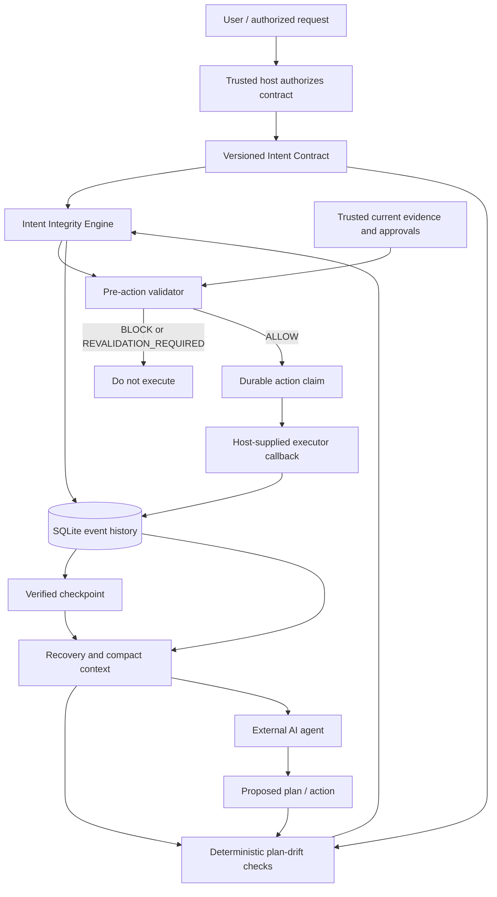

# Intent Drift in Long-Running AI Agents

**Intent Integrity** is an open-source engineering project for preserving an authorized user goal while an AI agent works across many steps, tool calls, context compactions, and restarts.

An agent can begin with a correct plan and later forget a constraint, use stale evidence, follow instructions found in an untrusted file, repeat an external action after a timeout, or claim completion without proof. This project adds a trusted intent contract and runtime checks around the agent. The model may propose actions; trusted code decides whether those actions may proceed.

> **Status:** The repository contains an implemented deterministic validator plus an initial runnable runtime scaffold: SQLite event history, hash-chain verification, checkpoints, structural plan-drift checks, compact context reconstruction, and fail-closed action claims. CI results for the latest branch and real external-agent integration must be verified separately. This is an early engineering implementation, not a production security certification or universal semantic drift detector.

## What is implemented

- Typed intent, action, evidence, approval, and validation-result models.
- The initially authorized contract is pinned in the task ledger. A changed goal or policy cannot silently replace it; amendments require an explicit, versioned host authorization reference.
- Strict JSON serialization/deserialization and a JSON Schema for intent contracts.
- Deterministic `ALLOW`, `BLOCK`, and `REVALIDATION_REQUIRED` decisions.
- Contract-owned action permissions, evidence requirements, and approval requirements.
- SQLite-backed, ordered task events with per-task hash-chain verification.
- Checkpoints with state-hash verification and recovery from a saved checkpoint plus later events.
- Deterministic plan checks for prohibited or unapproved action categories, missing dependencies, cycles, uncovered acceptance criteria, and invalidated assumptions.
- A guarded callback execution gate that validates first and stores an action claim before execution. Duplicate action IDs fail closed; exceptions are marked as an unknown outcome rather than retried automatically.
- Automated unit tests and a runnable end-to-end example.

## What is not yet implemented

- A universal wrapper that intercepts every tool call from arbitrary agents.
- A production MCP adapter or a second independent agent-framework adapter.
- Model-assisted semantic or trajectory drift detection. The current detector checks structured policy and plan relationships; it does not reliably interpret every natural-language deviation.
- Automatic verification of external side effects or provider-specific reconciliation after ambiguous outcomes.
- Authenticated identity/approval services, multi-tenant deployment, a dashboard, or production operational controls.
- A Gemma integration. The core remains model-independent; an optional model adapter should be added only behind validated interfaces and evaluated separately.
- Published benchmarks demonstrating improved drift detection or lower false-positive rates.

## Architecture



The diagram describes the implemented runtime scaffold and the integration responsibilities. It does not imply that a generic agent is automatically intercepted. A host must route every consequential tool action through this gate to prevent bypass.

## Runtime flow

1. The host authenticates the user and authorizes an `IntentContract`.
2. The engine records the authorized contract as a task-start event.
3. The plan is checked against allowed action categories and acceptance criteria.
4. Before an action, the validator checks the contract, trusted evidence, evidence freshness/resource versions, and required approvals.
5. Only `ALLOW` may reach the guarded execution callback. The action ID is claimed durably before the callback runs.
6. The result or ambiguous outcome is recorded. Reusing the same action ID fails closed.
7. The host saves a checkpoint containing the contract, plan, completed criteria, verified facts, and decisions.
8. On recovery, the engine verifies the event chain and checkpoint hash, reloads the checkpoint, restores the active authorized contract, replays later plan/progress/decision events, detects invalidated assumptions, and rebuilds a compact context anchored to the authorized intent.

A validation `ALLOW` means only that the checks represented in the contract passed at validation time. It does not prove an external operation succeeded or the whole task is complete.

## Quick start

Requirements: Python 3.11 or newer and Git if cloning.

```bash
git clone https://github.com/rumman52/Long-Running.git
cd Long-Running
python -m venv .venv
```

Windows PowerShell:

```powershell
.venv\Scripts\Activate.ps1
python -m pip install --upgrade pip
python -m pip install -e ".[dev]"
```

macOS / Linux:

```bash
source .venv/bin/activate
python -m pip install --upgrade pip
python -m pip install -e ".[dev]"
```

Run the original side-effect-free validation example:

```bash
python examples/basic_validation.py
```

Run the runtime demonstration:

```bash
python examples/long_running_task.py
```

Run tests and quality checks:

```bash
pytest
ruff check src tests examples
mypy src/intent_integrity
```

The runtime demo uses a local temporary SQLite database and demonstration callbacks. It does not publish a real report or connect to an external service.

## Decision meanings

| Decision | Meaning | Required behavior |
|---|---|---|
| `ALLOW` | All checks represented by the current validator passed. | The trusted host may proceed with execution safeguards. |
| `BLOCK` | A policy or authorization rule failed. | Do not execute. |
| `REVALIDATION_REQUIRED` | Evidence or contract state is missing, stale, invalidated, or outdated. | Refresh trusted state and validate again. |

A block takes precedence over a revalidation warning. Neither missing evidence nor an unknown external outcome grants permission to continue.

## Repository structure

```text
Long-Running/
├── .github/workflows/ci.yml
├── docs/
│   ├── ARCHITECTURE.md
│   ├── INTENT_CONTRACT.md
│   ├── ROADMAP.md
│   ├── RUNTIME_GUIDE.md
│   └── THREAT_MODEL.md
├── examples/
│   ├── basic_validation.py
│   └── long_running_task.py
├── schemas/intent-contract.schema.json
├── src/intent_integrity/
│   ├── models.py
│   ├── serialization.py
│   ├── validator.py
│   ├── events.py
│   ├── store.py
│   ├── drift.py
│   └── engine.py
└── tests/
    ├── test_serialization.py
    ├── test_validator.py
    ├── test_store.py
    ├── test_drift.py
    └── test_engine.py
```

## Security and limitations

- **Trusted boundary required:** if an agent can invoke tools without going through the host's gate, it can bypass validation.
- **No model authority:** model output, files, web pages, and tool results cannot amend the active contract or manufacture an approval.
- **Evidence is time-sensitive:** refresh and validate evidence close to execution.
- **TOCTOU remains possible:** a resource can change after validation but before an external action. Use provider-supported conditional operations, resource-version checks, and idempotency keys.
- **Ambiguous outcomes fail closed:** an exception after a side effect may mean the provider completed the operation. The action remains `UNKNOWN`; reconcile with the provider before taking any new action. Do not blindly retry with a new ID.
- **Hash chain is tamper-evident, not tamper-proof:** an attacker able to rewrite the whole database can recompute the chain. Production deployments need protected storage, access control, backups, and potentially externally anchored signatures.
- **Natural-language constraints need explicit enforcement:** storing a sentence does not make it machine-checkable.
- **No universal semantic guarantee:** the current detector finds structured plan and event inconsistencies, not every possible meaning-level drift.

See [Threat Model](docs/THREAT_MODEL.md) and [Runtime Guide](docs/RUNTIME_GUIDE.md) before integrating with tools that can affect external systems.

## Roadmap

See [docs/ROADMAP.md](docs/ROADMAP.md). Milestones should be marked complete only when acceptance tests and evidence support the claim.

## License

A license has not yet been selected. Until a license file is added, do not assume that this code is licensed for reuse.
