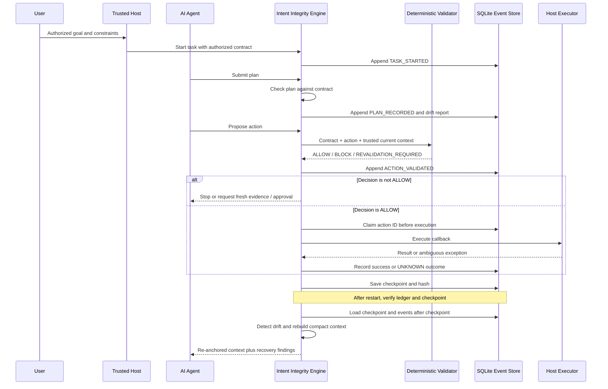

# Architecture

## Objective

Preserve the host-authorized user goal across long-running agent work and prevent controlled actions from proceeding when the policy, evidence, or approval state does not justify them.

## Component boundaries

| Component | Responsibility | Status |
|---|---|---|
| Intent contract and schema | Versioned goal, constraints, allowed/prohibited actions, evidence and approval requirements, assumptions, acceptance criteria | Implemented |
| Deterministic validator | Returns ALLOW, BLOCK, or REVALIDATION_REQUIRED from trusted inputs | Implemented |
| Event model | Typed task events for plans, validation, action attempts, invalidation, and checkpoints | Implemented |
| SQLite event store | Per-task sequence, idempotent event append, hash-chain verification, checkpoint storage, action claims | Implemented initial adapter |
| Plan-drift detector | Checks action categories, dependency graph, acceptance-criteria coverage, invalidated assumptions, selected event patterns | Implemented deterministic checks |
| Runtime engine | Connects plan checks, validation, event persistence, guarded callback execution, checkpoint and recovery | Implemented scaffold |
| Compact context builder | Reconstructs the original goal, constraints, progress, verified facts, decisions, and recent events | Implemented |
| Trusted host and identity | Authenticates user, authorizes initial contract and amendments, provides trustworthy evidence/approval records | Integration responsibility |
| Agent action adapter | Intercepts every controlled tool call and maps provider state into trusted validation inputs | Not yet implemented |
| Semantic/trajectory model | Optional model-assisted analysis for subtler natural-language drift | Not yet implemented |
| External outcome reconciler | Queries providers after timeouts and resolves ambiguous side effects | Not yet implemented |
| Evaluation suite | Measures detection, false alarms, recovery, task success, bypass resistance, and overhead | Initial unit tests only |

## System flow

## Trust and authorization

The host is the authority for who requested a task and which contract version is active. The agent may suggest a contract or plan, but model output alone must not activate a contract, remove a constraint, mark evidence verified, or grant approval.

Evidence and approval state must be populated by authenticated integration code. The validator checks only the fields it receives; it cannot prove that a compromised adapter told the truth.

## Drift detection levels

1. **Deterministic policy checks:** implemented in the validator. Rejects prohibited or non-allowlisted action categories, missing/invalid approvals, stale or invalidated evidence, and contract-version mismatch.
2. **Plan-structure checks:** implemented in the drift detector. Finds unauthorized categories, missing dependencies, dependency cycles, unknown criteria, uncovered criteria, and invalidated assumptions.
3. **Event-trajectory checks:** initial deterministic rules inspect recorded invalidations and action-validation events.
4. **Semantic drift:** not implemented. Future model-assisted analysis can compare proposed plan summaries with the contract, but must produce advisory signals only; trusted deterministic code and human authorization remain in control.

## Recovery semantics

Recovery verifies the task's event chain and the latest checkpoint hash. It restores the authorized contract, plan, completed criteria, verified facts, and prior decisions, then reads events after the checkpoint. Invalidated assumptions create blocking drift findings. The compact context explicitly says that external content and event payloads are records, not authority.

The checkpoint is a state snapshot, not a substitute for the event history. The history is retained so changes can be inspected.

## Action execution and duplicate prevention

The guarded execution path:
1. Validates the action against the current contract and trusted context.
2. Refuses to execute unless the result is ALLOW.
3. Claims the task/action ID in durable storage before invoking the callback.
4. Marks a successful callback as SUCCEEDED.
5. Marks an exception as UNKNOWN because the external side effect may have happened before the exception.
6. Refuses to claim the same action ID again.

This is an initial local safety primitive, not exactly-once execution across arbitrary providers. The host should use provider idempotency keys, conditional writes, and outcome reconciliation. A process crash after claiming but before recording a result leaves a claim that must be reconciled, not automatically retried.

## Storage and integrity

The SQLite adapter stores a monotonically sequenced event stream per task. Each event hash includes the prior event hash, so an edited or removed event is detectable when the chain is verified. Checkpoints have a separate SHA-256 state hash.

The hash chain is tamper-evident, not tamper-proof. Production use needs database access controls, backups, retention policies, operational monitoring, and potentially an externally anchored signature or write-once store.

## Key invariants

- The active contract is authorized outside the model.
- Only ALLOW passes the guarded execution gate.
- BLOCK takes precedence over revalidation.
- Missing or stale evidence is never treated as success.
- Consequential actions require valid scoped approvals.
- Reusing an action ID never invokes the executor twice through this gate.
- Ambiguous external outcomes fail closed.
- Untrusted content cannot amend intent or authorize actions.
- Completion claims must be backed by explicit acceptance evidence.

## Known gaps

No universal agent interception, provider-specific action adapter, external effect reconciliation, semantic model detector, production identity layer, or benchmark suite exists yet. Do not treat this scaffold as a production security guarantee.
