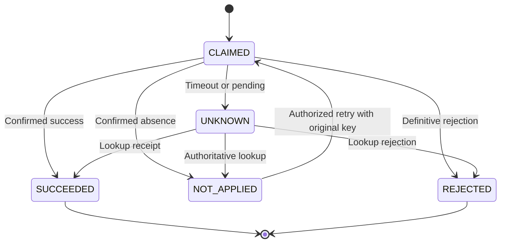

# External outcome reconciliation (M5)

When a provider accepts a write but the response is lost, repeating the write may create a
duplicate. M5 adds a provider-neutral coordinator that persists an immutable operation before
submission, looks up ambiguous outcomes after a restart, and guards explicit retries.

## Provider contract

Implement `ReconciliationProvider` in trusted host code and register it with
`ExternalActionCoordinator(engine, providers)`. The provider is responsible for these guarantees:

| Interface | Required behavior |
|---|---|
| `provider_id` | Stable namespace for a provider account and API semantics. Retain the same identity after restart; change it only when the actual namespace changes. |
| `idempotency_ttl_seconds` | Positive guaranteed retention window. The engine pins its deadline on the initial attempt and never extends it on retry. |
| `execute(ProviderRequest)` | Send the saved key and payload; atomically deduplicate the key, bind it to the payload and version condition, and enforce `expected_version` at the write boundary. Reject an expired deadline before any new effect. |
| `lookup(ProviderRequest)` | Read the outcome using the same key/identity without performing the write. Return a typed `ProviderOutcome`. |

`SUCCEEDED` requires a provider receipt/reference. `NOT_APPLIED` means a definitive observation
that the effect has not been applied and that using the same key remains safe; an eventually
consistent search miss or ambiguous HTTP 404 is `UNKNOWN`. `REJECTED` means a definitive
rejection without the intended effect, such as a failed conditional write. `PENDING`, malformed
responses, and execution/lookup exceptions keep the local claim unresolved as `UNKNOWN`.

A real adapter must establish these guarantees using its provider's actual API. If the provider
cannot atomically enforce a supplied deadline, deduplicate writes, bind the request, or reliably
look up outcomes, keep using the existing fail-closed callback gate and require manual
reconciliation. M5 is an implemented protocol and local reference demonstration; no live provider
adapter is claimed to be qualified by these tests.

## Initial submission

```python
coordinator = ExternalActionCoordinator(engine, (trusted_provider,))
result = coordinator.execute(
    contract,
    ActionRequest("publish-attempt", "publish"),
    trusted_current_context,
    ExternalOperation(
        provider_id=trusted_provider.provider_id,
        operation_id="publish-report-42",
        payload={"report_id": "42"},
        expected_version="report-v7",
    ),
)
```

The host constructs `operation_id` as the stable identity of the intended effect. A unique
SQLite constraint on `(provider_id, operation_id)` prevents claiming it again under another
action ID or task ID. An agent must not choose a new operation ID merely to bypass an ambiguous
outcome. The library cannot recognize that two independently named operations mean the same
real-world effect; hosts must maintain this mapping and route all writes through the boundary.

The coordinator rechecks the active contract, current plan, evidence, and approvals through the
engine, using its current clock. Before contacting the provider, one SQLite transaction commits
the action claim, immutable request and hash, and `ACTION_CLAIMED` event. The stored request
contains the original contract version, payload, conditional resource version, generated
idempotency key, and deadline. Retries do not accept replacement payloads or version conditions.

`submitted=True` means the coordinator invoked the provider adapter. It does not mean the
external effect succeeded. Read `result.record.action.status` and its provider observation.

## Recovery and retry



```python
# After reopening the same database and registering the same trusted providers:
records = coordinator.reconcile_pending(active_contract)

# Or inspect one ambiguous claim without submitting a write:
record = coordinator.reconcile(active_contract, "publish-attempt")

# Only after authoritative NOT_APPLIED, with fresh host evidence and approvals:
result = coordinator.retry(active_contract, "publish-attempt", trusted_current_context)
```

| Local state | Recovery or retry behavior |
|---|---|
| `CLAIMED` | May represent a crash before submission or after provider commit. Lookup only. |
| `UNKNOWN` | Lookup only; never blindly resubmit. |
| `NOT_APPLIED` | Refreshable absence observation. Explicit retry is eligible within the original deadline, after authorization and plan checks. |
| `SUCCEEDED` | Terminal success; no repeat submission. |
| `REJECTED` | Terminal rejection; no retry through this operation. |

Only the provider-aware coordinator can resolve its claims. Legacy callback claims lack the
required immutable metadata and stay fail closed; they cannot be automatically upgraded into
retryable operations. An authorized contract amendment prevents retry under the original
contract version, while read-only lookup of the prior outcome remains available.

SQLite revision checks serialize competing retries across connections. Each state change and
its audit event commit together. A late lookup or response cannot overwrite a newer revision.
`NOT_APPLIED` remains refreshable: an in-flight submission may commit after an absence lookup,
so both `reconcile` and `reconcile_pending` query it again rather than treating it as terminal.
An audit write failure rolls back the state transition; if the effect already occurred, the
claim remains unresolved and a later lookup can recover it. Completion verification sees the
resolved action state through the existing action ledger.

Task policy can still change between validation and the external write, as with the original
execution gate. Hosts must serialize authorization changes with submissions where this matters
and use provider-side conditional writes. Idempotency guarantees depend on provider compliance,
deadline enforcement, correct host operation identities, and retaining the database. Database
administrators remain trusted; hashes do not make a fully writable database tamper-proof.

## Reproducible verification

```bash
python examples/external_reconciliation.py
python -m pytest tests/test_reconciliation.py -q
python -m pytest -q
python -m ruff check src tests examples
python -m mypy src/intent_integrity
```

The example stores exactly one report in a separate provider database, loses its response,
reopens the agent database, and recovers `SUCCEEDED` through lookup. The tests inject process
termination both before and after provider commit, lost responses, provider outages, malformed
responses, lookup failures, expired keys, revoked approvals, stale resource versions, competing
SQLite connections, delayed observations, and audit-write failures. They use local ledgers and
do not contact external services.
